# Documentacion de la practica DNS 
En este documento se registraran los pasos de configuracion del servidor DNS y las capturas de pantalla de las pruebas realizadas. 


# Práctica: Configuración de un servidor DNS con BIND9

**Autor:** Cristóbal  
**Proyecto:** dns-paso-a-paso  


## 1. Objetivo

El objetivo de esta práctica es instalar, configurar y comprobar un servidor DNS autoritativo utilizando BIND9 en una máquina virtual Debian.


## 2. Control de versiones con Git y GitHub

Se ha creado un repositorio privado en GitHub con el nombre `dns-paso-a-paso`.

### Captura 1. Repositorio de GitHub

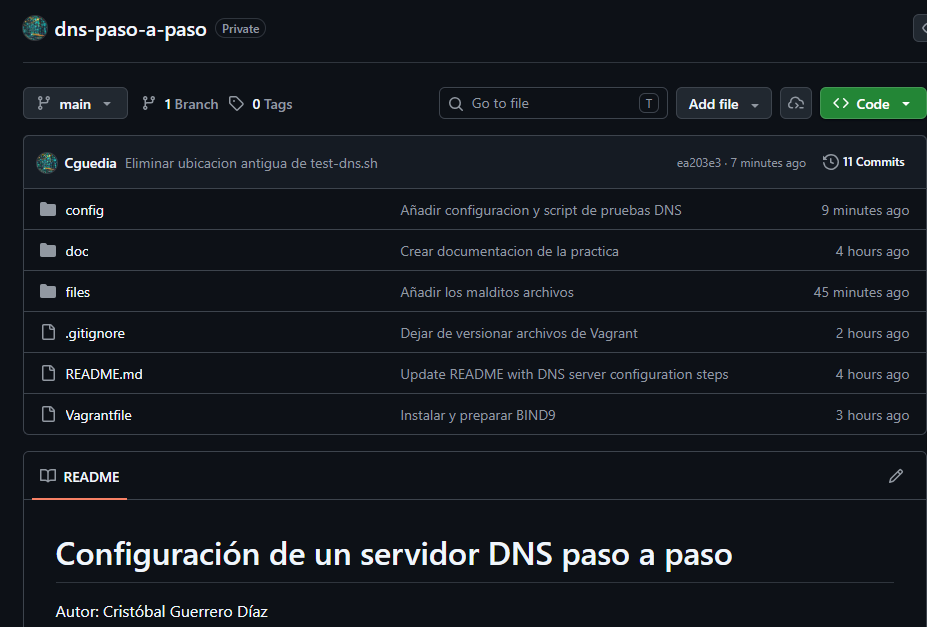

*Se muestra el repositorio y su estructura de archivos.*


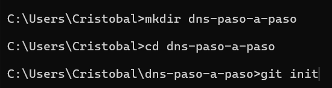


## 3. Infraestructura como código con Vagrant

Se utiliza Vagrant para desplegar una máquina virtual Debian en la que se instala y configura el servidor DNS.

La máquina dispone de una interfaz de red privada con una dirección IP de la red `192.168.56.10/24` en mi caso.


### Comandos de despliegue

```bash
vagrant up
vagrant ssh
```

```bash
vagrant status
```


## 4. Instalación del servidor DNS

Antes de realizar las pruebas, se comprueba que el cliente no tenga entradas locales que falseen la resolución DNS en el archivo `hosts`.

En Debian, se revisa `/etc/hosts`. En Windows, se revisa `C:\Windows\System32\drivers\etc\hosts`.

Se instalan los paquetes necesarios:

```bash
sudo apt update
sudo apt install bind9 bind9utils bind9-doc dnsutils
```

Se comprueba el estado del servicio:

```bash
sudo systemctl status bind9
```

### Captura 4. Instalación de BIND9

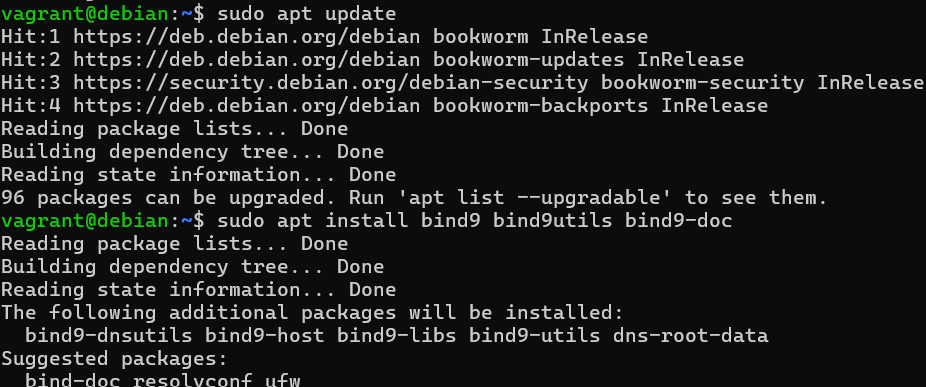

*Se muestra la instalación de los paquetes y el estado del servicio.*


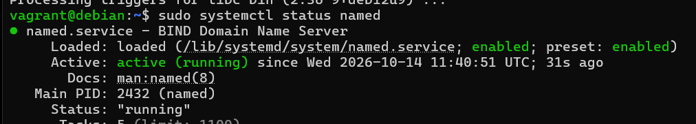


### 5.1. Configuración de IPv4

Se modifica el archivo `/etc/default/named` para indicar que BIND9 debe trabajar con IPv4.
Se hace un backup  `/etc/default/named.backup`


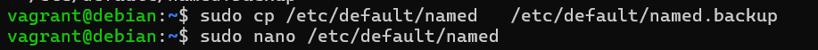


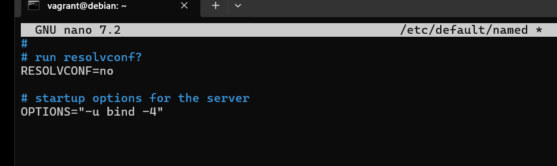


### 5.2. Archivo principal named.conf

El archivo `/etc/bind/named.conf` incluye los archivos principales de configuración:
Se hace un backup  `/etc/default/named.conf.backup`

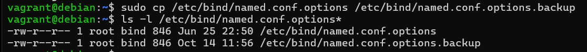

```conf
include "/etc/bind/named.conf.options";
include "/etc/bind/named.conf.local";
include "/etc/bind/named.conf.default-zones";
```

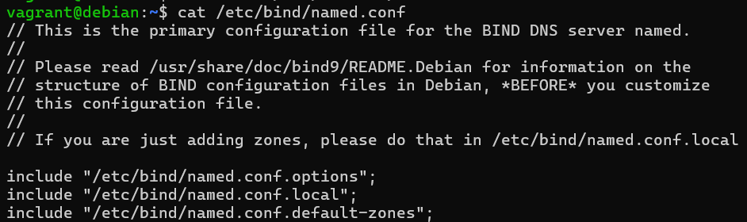


### 5.3. Configuración de named.conf.options

Antes de modificar el archivo se crea una copia de seguridad:

```bash
sudo cp /etc/bind/named.conf.options \
  /etc/bind/named.conf.options.backup
```

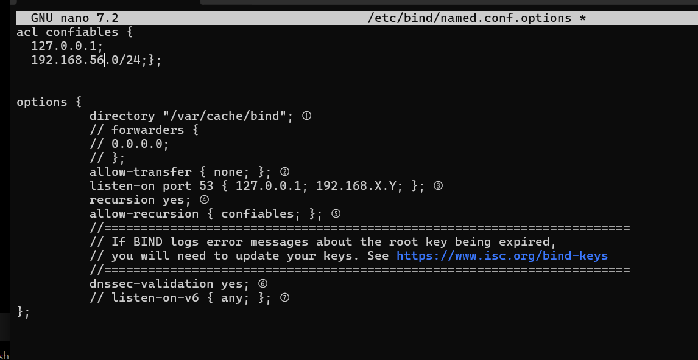


## 6. Configuración de la zona directa

En `/etc/bind/named.conf.local` se declara la zona:

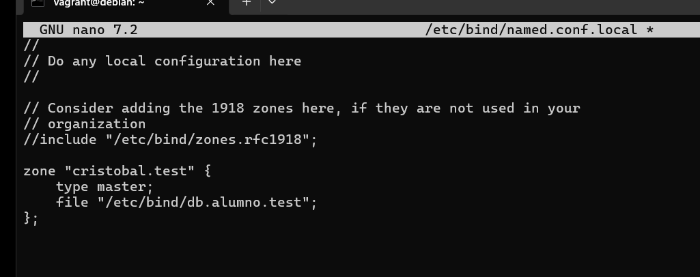


*Se muestra el archivo de zona directa y sus registros DNS.*


## 7. Configuración de la zona inversa

La zona inversa permite obtener el nombre asociado a una dirección IPv4.

Para la red `192.168.56.10/24`, se declara la zona:

```conf
zone "56.168.192.in-addr.arpa" {
    type master;
    file "/var/lib/bind/cristobal.test.rev";
};
```
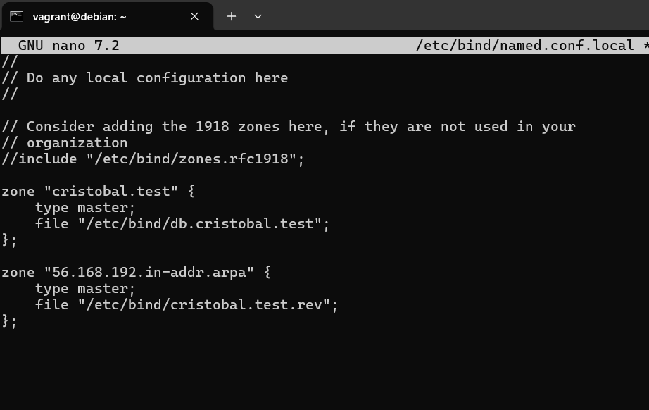

El archivo `/var/lib/bind/cristobal.test.rev` contiene los registros de resolución inversa.

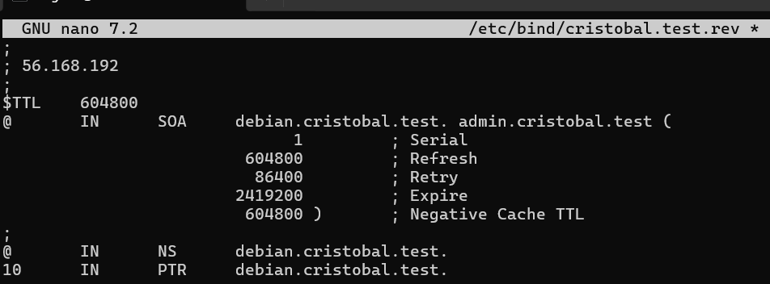


## 8. Comprobación de la configuración

Se comprueba la sintaxis general de BIND9:


```bash
sudo named-checkconf
```


Si las comprobaciones son correctas, las herramientas deben indicar que las zonas se han cargado correctamente y devolver `OK` para cada zona.

Se reinicia el servicio:

```bash
sudo systemctl restart bind9
sudo systemctl status bind9
```

### Captura 8. Validación de las zonas

## 9. Pruebas de resolución DNS

Se realizan las consultas directamente al servidor DNS mediante `dig` y `nslookup`.

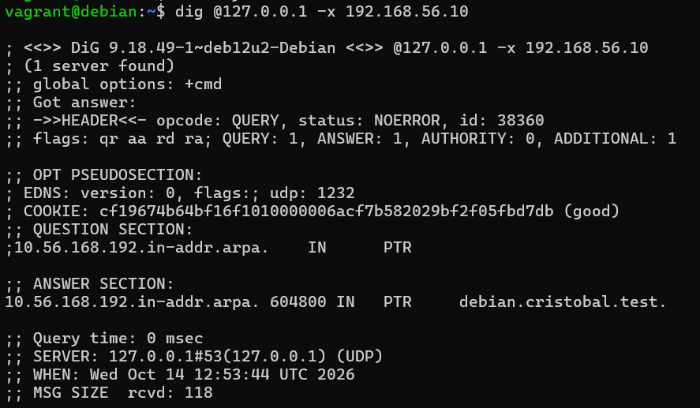

*Se muestran las consultas directas e inversas realizadas al servidor.*


## 10. Tareas de ampliación


### 10.1. Registro CNAME y TXT

Se añade un alias `web` que apunta al nombre canónico del servidor.

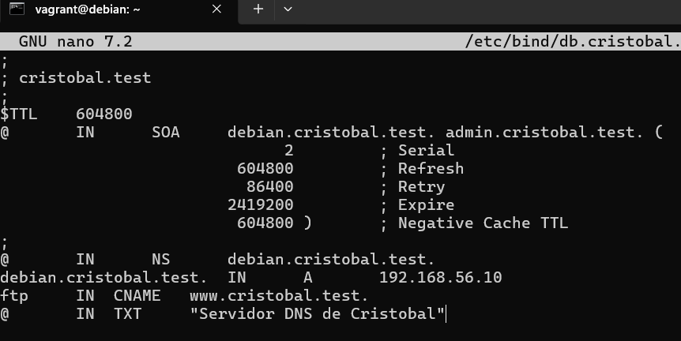


## 11. Script de autocomprobación

Se utiliza un script llamado `test-dns.sh`, situado en la raíz del repositorio, para automatizar las comprobaciones principales.

El script debe verificar la sintaxis de BIND9, las zonas y las resoluciones DNS.

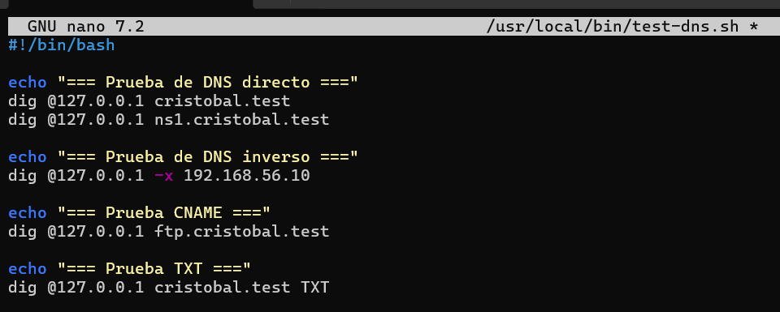
Se ejecuta mediante:

```bash
chmod +x test-dns.sh
sudo ./test-dns.sh
```

Las comprobaciones deben devolver resultados satisfactorios para considerar correcto el despliegue.


### Captura 14. Ejecución del script de pruebas

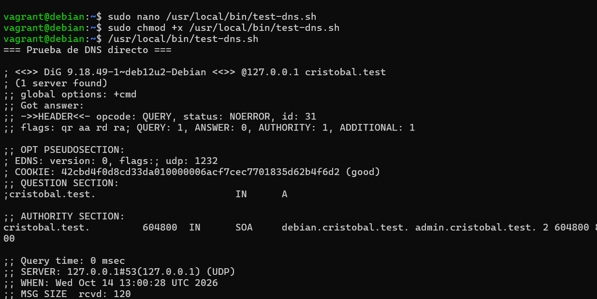

*Se muestra la ejecución de test-dns.sh y los resultados obtenidos.*


